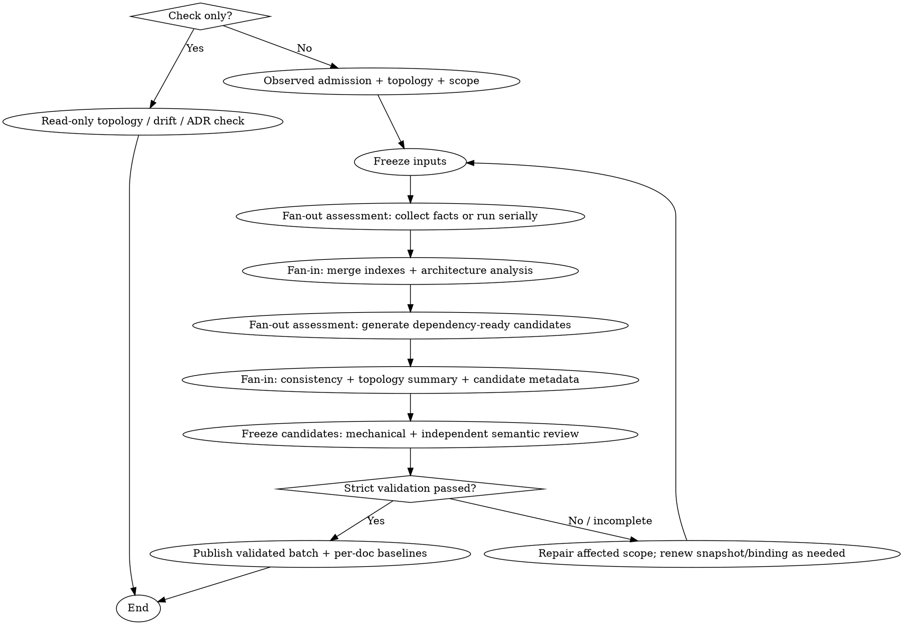

# ease-arch-documentation

## 证据与决策强化契约

新生成或定向更新前必须读取 `references/evidence-and-decision-contract.md`（命令入口从 ease-arch-documentation 技能目录读取）。采用 2.2 证据校验；机械 PASS 不等于完整 PASS。遗留版本只读兼容，最终发布仍需语义证据。测试资产位于 docs/qa 与领域 testcases，arch-docs 不改写 TC。


## 异步任务检测

> **优先检测**：在执行本技能前，首先检测用户输入是否包含明确且非否定的异步意图。

**统一触发契约**：
- `--async` 是唯一结构化异步标记
- 用户明确表达“异步执行”“云端处理”“后台执行”等自然语言意图时，也可触发
- `[@ease]` 是路由标记，单独出现不触发异步
- “不要异步”“不使用云端”等否定表达不得触发

**触发示例**：
- `/ease:arch-docs --async 生成系统概览`
- `/ease:arch-docs [@ease]--async 更新 API 文档`
- `/ease:arch-docs 请在云端处理完整架构文档`

**检测逻辑**：
```bash
# 结构化参数只识别 --async；自然语言请求交给意图识别并排除否定表达
USER_INPUT="$1"  # 用户完整输入
if [[ "$USER_INPUT" =~ (^|[[:space:]])--async([[:space:]]|$) ]]; then
    # 触发 async-task 技能，将任务提交到云端
    # 任务类型：技术任务 (issue_type=5, 标题前缀=[task])
    # 任务内容：完整的用户输入（包括命令）
fi
```

**触发后的行为**：
1. 将完整的用户输入（如 `/ease:arch-docs --async 生成文档`）作为任务描述
2. 使用 `async-task` 技能提交到云端后台
3. 向用户反馈"任务已提交到云端后台"

## Overview

用"**拓扑发现 → 索引（证据）→ 架构深度分析（因果）→ 生成（6份文档）→ 门禁（可验证）**"稳定产出架构文档。

## Role Contract

- **主角色 — 技术文档工程师（Technical Documentation Engineer）**：从代码、配置和已批准的架构记录中整理系统现状，保证结论可追溯、可复核。
- **允许**：生成或更新架构文档、索引、图表和元数据；记录代码与文档漂移；按证据标注置信度。
- **禁止**：在证据不足时补写“合理架构”、替团队作出新的架构决策、掩盖代码与文档冲突，或把建议描述成已实现事实。
- **冲突处理**：代码与已批准文档冲突时，同时记录两方证据并标记漂移；无法从权威证据裁决时移交 `ease-architecture`，不得自行定案。
- **同步边界**：README、CLAUDE.md 等全局文件仅在用户显式 opt-in 后按本技能的安全同步规则更新；文档任务不修改生产代码。

### 内容定位

本技能生成的是**当前状态架构知识库**，而不是代码清单或新架构方案。文档集要回答六类问题：

1. **边界**：系统/模块负责什么、不负责什么，与谁交互
2. **运行**：如何部署、调用、存储、失败和恢复
3. **约束**：安全、一致性、兼容性、供应链和质量属性的已实现机制
4. **风险**：证据冲突、未知项、漂移和变更影响
5. **因果**：驱动力如何形成机制，机制在哪里执行，故障如何传播与恢复
6. **演进**：哪些不变量、耦合点和兼容接缝限制未来变更

正文只保留架构摘要和关键条目；全量接口、字段、配置和依赖清单保存在外置索引，避免生成不可阅读的巨型 Markdown。

**生成或更新路径的第一步始终执行拓扑发现**（`references/generate-topology.md`）。纯 `--check` 路径只读验证已有 topology 与当前构建/目录信号是否一致；不得创建目录或重写文档。即使已有 `topology` 字段也不能跳过有效性验证。

### 单系统模式

目标输出目录：

```
docs/system/
├── 01_SYSTEM_OVERVIEW.md
├── 02_CORE_MODULES.md
├── 03_API_INTERFACE.md
├── 04_DATA_MODEL.md
├── 05_CONFIG_MANAGEMENT.md
├── 06_UTILS_LIBRARIES.md
└── metadata.json
```

### 多子系统模式

对每个真实子系统在独立目录下生成完整文档，再在 `docs/system/` 根目录生成依赖架构汇总：

```
docs/system/
├── 00_TOPOLOGY.md                # 仓库模块依赖架构汇总
├── user/                         # 用户管理子系统（目录名用业务名，不加 -service 后缀）
│   ├── 01_SYSTEM_OVERVIEW.md
│   ├── 02_CORE_MODULES.md
│   ├── 03_API_INTERFACE.md
│   ├── 04_DATA_MODEL.md
│   ├── 05_CONFIG_MANAGEMENT.md
│   ├── 06_UTILS_LIBRARIES.md
│   └── metadata.json
├── order/                        # 订单子系统
│   ├── 01_SYSTEM_OVERVIEW.md
│   └── ...
└── ...
```

公共依赖模块不单独生成文档，仅在 `00_TOPOLOGY.md` 和各子系统文档中体现依赖关系。

格式约束：
- 默认**中文输出**（除非项目约定英文）
- 优先 Mermaid 图表（渲染失败降级为文本图，记录 Warning）
- 代码/配置/DDL 引用使用代码块

## When to Use

**Use when:**
- `docs/system/` 目录缺失或不完整
- 文档与实际代码不一致（接口已变更但文档未更新）
- 大型项目手动维护文档困难（代码量大/注释稀少/知识分散）
- 需要可追溯的架构文档（每个结论有证据来源）

**Do NOT use:**
- 只写"产品介绍/营销文案/README 文案" → 使用写作/文档类能力
- 没有代码可读或不允许扫描仓库
- 希望"自动改动 README/CLAUDE.md"但 **不接受显式 opt-in**（本技能默认不做全局同步）

### 无 observed 证据时的确定性结果

如果仓库没有可扫描的源码、构建文件、配置、IaC、测试或运行证据，返回：

```text
NO_OBSERVED_BASELINE
当前仓库只有目标意图或为空；请先执行 /ease:bootstrap-system。
```

此结果不生成 `docs/system/`、`metadata.json` 或六件套占位文档。`docs/architecture/target/` 可以作为后续实现对账输入，但不能替代 observed 证据。已有代码但缺少 `docs/system/` 不属于该结果，应正常执行拓扑发现和当前状态文档生成。

## Quick Reference

| 操作 | 关键输入 | 关键输出 | 参考 |
|---|---|---|---|
| 拓扑发现 | 仓库目录结构、构建文件 | topology 类型判定 + 子系统列表 | `references/generate-topology.md` |
| 首次全量生成 | 仓库代码 | 6份文档 + metadata.json（每子系统各一份） | `references/generate-project-index.md` + `generate-*.md` |
| 架构深度分析 | topology + 事实索引 | 关键路径、不变量、质量场景、故障传播、演进热点 | `references/architecture-depth-analysis.md` |
| 增量更新 | git diff | 受影响子系统 + 受影响文档 | `references/generate-project-index.md` (增量策略) |
| 漂移检测 | metadata.json + git diff | 终端漂移报告 + drift_status | `references/generate-project-index.md` (漂移检测) |
| 质量检查 | 生成结果 | 校验报告 | `references/quality-gates.md` |

## Fan-out assessment

直接调用本 Skill 或通过 `arch-docs` Command 调用时，确认本地执行意图、完成 observed 准入与拓扑发现后，在事实采集前评估是否 fan out；文档生成前按依赖再次评估。无需 ease-agent、额外用户参数或规划文件；异步路由沿用原规则，本地并行不触发云端提交。

至少两个工作包输入就绪、边界明确、互不依赖未完成结果、文件与可变资源写入互斥，且收益预计超过分派与汇总成本时才使用 subagent。小任务、强耦合任务、用户要求串行、能力不可用或额度不足时串行完成；通常使用 2–3 个工作包并服从宿主实际额度与权限。纯 `--check` 保持现有只读检测路径，不进入两轮生成 fan out。

执行生成或更新时读取 `references/fan-out-workflow.md`：该文件定义两轮 fan out、Fan-in、工作包权限、失败处理与验收顺序。Command 引用同一规则，不重复分派；已被分派的子任务不再次 fan out。并行只改变阶段内部执行方式，不改变 2.2 证据与交付契约。

## Core Workflow Flowchart



## Non-negotiables

### Evidence-based generation
- **先索引、后写文档**：文档内容必须以索引为事实来源
- **事实状态**：每条 claim 标为 `observed`、`approved_intent`、`inferred` 或 `unknown`
- **证据引用**：关键结论至少 1 条结构化 evidence，正文透传为 `来源: <path>:<line> (symbol)`
- **不确定性显式化**：无法证实内容标注 `低置信/待确认`；正文突出最多 3 个阻断问题，其余未知项保留在结构化清单
- **不适用也需证据**：必须说明扫描范围以及为何判定不适用，不得用“不适用”绕过证据门禁

### Architecture-depth synthesis
- 全量生成或用户要求深入架构时，必须读取 `references/architecture-depth-analysis.md`
- 先从事实索引派生 `architecture_analysis_index`，再写深度结论；派生项必须记录 `derived_from`，不得形成无源的第二套事实
- 架构解释使用“驱动力/约束 → 机制 → 执行点 → 运行结果 → 代价/残余风险”，没有批准证据时不得猜测历史设计理由
- 每个有运行入口的 deployable 至少覆盖一条关键路径、一个可观察失败分支与恢复证据/缺口；纯库项目分析调用/扩展路径或给出不适用证据
- 核心状态写入和信任边界必须关联不变量与执行点；只有文档声明而无执行机制时标记为“未强制执行”
- 质量属性按刺激、环境、对象、响应和度量形成场景；存在框架/配置不等于已经达到质量目标
- 演进热点必须区分结构、时间、数据、变更和供应链耦合；热点不自动等于坏设计或重构结论

### Quality gates
- 生成/更新后必须按 `references/quality-gates.md` 校验
- 全量生成使用 `full` 模式校验完整文档集；定向/增量生成使用 `partial` 模式，仅校验本次实际生成的文档及依赖索引
- 先执行 `scripts/validate_arch_docs.py` 的机械门禁，再执行语义一致性与证据抽样反查
- Fail 必须回退修正索引并重生成受影响文档

### Safe sync rules
- 对 README/CLAUDE.md 等手写文档的更新必须 opt-in
- 只能更新标记块（避免误改手写内容）

### Template usage (禁止直接复制)
- `references/output-structure/` 中的文件**仅供 Agent 了解输出文档的章节结构**
- **绝对禁止**将 `references/output-structure/` 中的任何文件直接复制到用户项目的 `docs/system/` 目录
- 生成文档时必须基于用户项目的**实际代码分析**（读取 build.gradle/pom.xml/源码/配置文件等），而非复制示例内容
- 输出骨架只包含中性占位说明；占位文字不得进入最终文档

### 六份文档的内容职责

| 文档 | 核心问题 |
|---|---|
| `01_SYSTEM_OVERVIEW.md` | 系统职责/边界、上下文、驱动力—机制链、部署运行时、故障域、质量属性与风险 |
| `02_CORE_MODULES.md` | 业务能力、模块边界、关键流程、不变量/执行点、耦合与演进热点 |
| `03_API_INTERFACE.md` | 协议无关契约及安全、错误、调用预算、时间耦合、故障传播和兼容性 |
| `04_DATA_MODEL.md` | 数据所有权、模型、血缘、关键写路径、不变量、一致性、生命周期和恢复 |
| `05_CONFIG_MANAGEMENT.md` | 配置来源/优先级、环境差异、Secret、控制面、变更爆炸半径和回滚 |
| `06_UTILS_LIBRARIES.md` | 共享能力、依赖中心性、横切行为、供应链、升级和演进约束 |

## Output Structure

### 单系统模式

```
docs/system/
├── 01_SYSTEM_OVERVIEW.md
├── 02_CORE_MODULES.md
├── 03_API_INTERFACE.md
├── 04_DATA_MODEL.md
├── 05_CONFIG_MANAGEMENT.md
├── 06_UTILS_LIBRARIES.md
└── metadata.json
```

### 多子系统模式

```
docs/system/
├── 00_TOPOLOGY.md                # 仓库模块依赖架构汇总
├── <subsystem-a>/                # 子系统 A（目录名用业务名）
│   ├── 01_SYSTEM_OVERVIEW.md
│   ├── 02_CORE_MODULES.md
│   ├── 03_API_INTERFACE.md
│   ├── 04_DATA_MODEL.md
│   ├── 05_CONFIG_MANAGEMENT.md
│   ├── 06_UTILS_LIBRARIES.md
│   └── metadata.json
├── <subsystem-b>/                # 子系统 B
│   └── ...
```

- 子系统目录名使用业务/领域名，**不添加** `-service`、`-module` 等技术后缀
- 公共依赖模块不单独生成文档
- 每个子系统拥有独立的 `metadata.json`

### 团队协作专用目录（幂等创建）

生成 `docs/` 结构时，同步为**测试人员**和**运维人员**创建项目级共享目录及 README 说明：

```
docs/
├── qa/                           # 测试人员专用目录（存放测试人员关心的案例信息）
│   └── README.md
├── ops/                          # 运维人员专用目录（存放生产事故与处理排查方式）
│   └── README.md
└── system/                       # 架构文档（单系统或多子系统结构，见上）
    └── ...
```

- **幂等**：`docs/qa/`、`docs/ops/` 是项目级共享目录（整个项目仅一份，不随单/多子系统模式变化，不放入 `docs/system/` 内）；若目录或 README 已存在则**跳过、不覆盖**
- **执行边界**：仅在实际生成/更新架构文档时创建；纯漂移检测（`--check`/查看意图）**不**创建
- README 内容固定：`qa/README.md` 说明测试案例信息归属；`ops/README.md` 说明生产事故与排查经验归属

> **注意**: 场景架构模板由 skill 内置提供（`references/scenario-templates/`），不会生成到用户项目中。`flow-2-design` 阶段直接从内置路径加载模板。同样，`references/output-structure/` 中的输出结构参考文件也**不会**直接复制到用户项目的 `docs/system/` 目录。

Format constraints:
- 默认**中文输出**（除非项目约定英文）
- 优先 Mermaid 图表（渲染失败降级为文本图，记录 Warning）
- 代码/配置/DDL 引用使用代码块

## Common Mistakes

| 错误 | 症状 | 修复 |
|---|---|---|
| 先写文档再建索引 | 文档漂移、幻觉风险高 | 强制先生成/更新 indexes，再写对应文档 |
| "应该/可能/一般来说" | 误导读者，门禁无法通过 | 统一用 `低置信/待确认` 结构 + 给证据/问题 |
| 同步更新手写文档不加边界 | 误改手写内容，造成信任危机 | 必须 opt-in + 只更新标记块 + 输出同步报告 |

## Incremental Update Strategy

详见：`references/generate-project-index.md`

当出现以下任一情况时，应退化为全量：
- 找不到 git 信息 / commit_id
- metadata.json 缺失/损坏
- 变更范围无法收敛（大规模重构/目录迁移）

### 文档级基线追踪

metadata.json 中 `last_generation.per_doc` 按文档独立记录 commit_id：
- **全量生成**：所有 per_doc 的 commit_id 更新为当前 HEAD
- **增量生成**（指定文档类型）：仅更新被生成文档的 commit_id，其他保持不变
- **漂移集合**：全量生成成功时可清空 `stale_docs`；增量生成时，`stale_docs` 取原集合减去本次实际生成文档集合的差集，保留其他漂移文档
- **向后兼容**：若 per_doc 不存在，所有文档共用全局 commit_id

## Drift Detection

通过 `--check` 参数或工作流嵌入触发，快速检测架构文档与代码的漂移状态。

**检测流程**：
1. 读取 metadata.json，无文档基线则提示先全量生成，但仍检查已有 ADR
2. 从 per_doc 中找到最旧 commit_id，执行 `check_architecture_drift.py --base <oldest> --mode worktree --policy warn`
3. 对每个文档，按该文档自己的基线获取提交和工作区变更（由 check_architecture_drift.py 完成）
4. 将变更映射到 detector、索引 claim 和依赖边，记录 changed_claims、影响对象、兼容性风险、理由与置信度；不得只凭目录名或常识裁决
5. 输出漂移报告并更新 `drift_status.assessments`

**工作流嵌入**：flow-3-implement 和 git-commit 完成后自动执行漂移检查，文档 stale 附加提醒；生效的 ADR 冲突/缺证据在 Flow 3 独立交付验收中阻断。git-commit 仍使用 warn，不改变提交行为。

详见：`references/generate-project-index.md`（漂移检测章节）

## See Also

- `references/generate-topology.md` - 多子系统拓扑发现规范
- `references/generate-project-index.md` - 索引构建规范
- `references/architecture-depth-analysis.md` - 架构因果、关键路径、不变量、故障传播与演进分析规范
- `references/generate-*.md` - 各文档生成标准
- `references/scenario-classification.md` - 场景分类体系与识别规则（flow-2-design 使用）
- `references/scenario-template-writing-guide.md` - 模板编写指南（维护内置模板时使用）
- `references/scenario-templates/` - 内置场景模板库（flow-2-design 直接从此加载）
- `references/quality-gates.md` - 质量门禁规范
- `references/sync-system-docs.md` - 安全同步规则
- `references/minimal-end-to-end-example.md` - 最小示例
- `references/output-structure/` - 输出文档章节结构参考（**仅供参考，禁止直接复制到用户项目**）
- `references/output-structure/README.md` - 结构参考的使用说明和禁止事项
