# Ease POC — 技术选型验证技能

## Overview

用最小可运行实验验证技术假设，给出可审查证据与决策建议，同时评估对系统架构的影响。

**核心思维升级**：POC 不仅验证"能不能用"，更要回答"该不该用"和"怎么用好"。

## When to Use

**Use this skill when you need to:**

- 快速验证新技术/新框架/新库的可行性（≤30 分钟）
- 对比多个技术方案（性能、集成成本、架构适配度等）
- 验证集成方案是否可行（API、数据库、消息队列等）
- 评估引入某个技术替代现有方案的架构影响
- 验证 NFR 指标是否满足（性能、安全、可用性等）

**Do NOT use when:**

- 需要完整功能开发（应使用 `ease-coding`）
- 需要架构设计评审（应使用 `ease-architecture`）
- 需要编写生产级代码（应使用 `ease-spec`）

## POC Hypothesis Classification（假设分类引擎）

借鉴 flow-2-design 的场景识别机制，POC 在启动时对验证假设进行加权分类：

### 分类维度与权重

| 维度 | 权重 | 评估内容 |
|------|------|----------|
| 技术假设类型 | 40% | 新框架/性能优化/迁移/集成/安全 |
| 架构影响范围 | 30% | 局部组件/跨模块/全局基础设施 |
| 风险等级 | 20% | 低（可逆）/中（需回滚方案）/高（不可逆） |
| 验证复杂度 | 10% | 独立验证/需外部依赖/需多环境 |

### POC 类型与对应策略

| POC 类型 | 识别特征 | 核心验证策略 | 时间预算 |
|----------|----------|-------------|----------|
| **Feasibility**（可行性） | "能不能用""支不支持" | Hello World + 集成点验证 | ≤15 min |
| **Performance**（性能） | "够不够快""能撑多少" | 基准测试 + 对比分析 | ≤30 min |
| **Migration**（迁移） | "能不能换""升级影响" | 最小迁移路径 + 回滚验证 | ≤30 min |
| **Integration**（集成） | "能不能接""数据怎么映射" | 接口适配 + 数据流验证 | ≤20 min |
| **Security**（安全） | "安不安全""合不合规" | 安全扫描 + 合规对照 | ≤25 min |
| **Architecture Fit**（架构适配） | "适不适合我们""怎么融入" | 架构影响分析 + 约束兼容验证 | ≤30 min |

**分类判定**：若最高分 ≥ 0.6，采用对应策略；0.4-0.6 标记"低置信度"并合并相邻类型；< 0.4 使用通用验证流程。

## Quick Reference

| 你要验证什么 | 最小实验 | 关键指标 | 架构影响维度 | 输出 |
|---|---|---|---|---|
| 新库/框架是否可用 | 最小 Hello World + 与现有组件集成点 | 兼容性/依赖冲突/开发成本 | 依赖拓扑/模块边界 | POC 报告 + ADR 草稿 + 风险 |
| 性能是否满足 | 基准测试（baseline vs new） | p95/吞吐/CPU/内存 | 资源配额/横向扩展能力 | 对比结论 + 容量规划建议 |
| 迁移是否可行 | 最小迁移路径验证 | 变更面/回滚成本 | 模块耦合度/数据兼容 | go/no-go + 迁移步骤 + 回滚方案 |
| 集成是否可行 | 最小集成代码 + Mock | 接口适配/数据映射 | 数据流/错误传播/超时链 | 集成评估 + 适配方案 |
| 架构适配性 | 约束兼容性检查 + 架构图叠加 | 约束冲突数/改造工作量 | 全维度 | 架构适配报告 + 改造清单 |

## POC Decision Flowchart

```dot
digraph poc_decision {
    "Technical question?" [shape=diamond];
    "Need runnable evidence?" [shape=diamond];
    "≤ 30 min trial?" [shape=diamond];
    "Use ease-poc" [shape=ellipse, style=filled, fillcolor=lightblue];
    "Use ease-architecture" [shape=box];
    "Use ease-coding" [shape=box];

    "Technical question?" → "Need runnable evidence?";
    "Need runnable evidence?" → "≤ 30 min trial?";
    "Need runnable evidence?" → "Use ease-architecture" [label="No - strategic decision"];
    "≤ 30 min trial?" → "Use ease-poc" [label="Yes"];
    "≤ 30 min trial?" → "Use ease-coding" [label="No - full feature"];
}
```



## Architecture Impact Assessment（架构影响评估）

每个 POC 必须从架构视角评估影响，借鉴 flow-2-design 的六维度评审框架：

| 影响维度 | 评估要点 | 输出 |
|----------|----------|------|
| **依赖拓扑** | 新增/变更的依赖链，是否引入传递依赖冲突 | 依赖影响图 |
| **模块边界** | 是否改变现有模块职责划分，是否违反限界上下文 | 边界影响说明 |
| **数据架构** | 数据模型变化、存储层影响、数据迁移需求 | 数据影响评估 |
| **接口契约** | API 变更、接口版本兼容、协议适配需求 | 契约变更清单 |
| **运维体系** | 部署方式变化、监控指标变化、告警阈值调整 | 运维影响清单 |
| **NFR 传导** | 性能/安全/可用性/一致性的连锁影响 | NFR 影响矩阵 |

### 影响等级判定

| 等级 | 定义 | 评估深度要求 | 后续动作 |
|------|------|-------------|----------|
| **L0 局部** | 单模块内部，无外部接口变更 | 六维度判断级评估（现有） | POC 结论可直接指导开发 |
| **L1 模块级** | 跨 2-3 个模块，需协调 | 六维度 + 模块设计深水区评估 | 需 ease-architecture 评审后再开发 |
| **L2 系统级** | 影响全局架构或多条业务线 | 六维度 + 模块设计深水区 + 冲突检测 | 必须经过 flow-2-design 全流程设计 |
| **L3 基础设施** | 涉及中间件/数据库/部署架构变更 | 六维度 + 模块设计深水区 + 冲突检测 + NFR 量化验证 | 必须有专项架构评审 + 灰度方案 |

### Module Design Impact Assessment（模块设计影响深水区）

L1+ 影响 POC 必须执行模块设计深水区评估，从"是否影响"升级为"具体怎么影响"，为后续 flow-2-design 提供可直接消费的输入。

#### 评估维度

| 维度 | 评估内容 | 输出 |
|------|----------|------|
| **模块 I/O 映射** | 受影响模块的输入/输出变更清单，包括新增/变更/删除的参数、返回值、异常 | 模块 I/O 变更表（before → after） |
| **模块调用关系重绘** | 模块间调用关系的变化（新增调用链/变更调用方式/移除调用），绘制 before/after 对比 | 模块依赖关系变更图 |
| **接口契约变更预测** | 哪些模块的哪些接口需要变更、影响范围（调用方数量）、是否需要版本迁移 | 接口契约变更清单（含调用方影响分析） |
| **数据架构传导路径** | 数据模型变更 → 存储层影响 → 一致性保障变化 → 迁移需求的完整传导链 | 数据架构传导链路图 |
| **框架代码影响预判** | POC 结论采用后，需要生成/修改哪些框架代码文件（controller/service/dao/dto 等） | 框架代码影响清单（映射到 flow-2-design 的模块划分） |

#### 触发条件

- L0：不触发深水区评估，保持现有六维度判断级评估即可
- L1：触发模块 I/O 映射 + 接口契约变更预测 + 框架代码影响预判
- L2：全部 5 个维度
- L3：全部 5 个维度 + NFR 量化验证路径（见优化 4）

## Constitution Awareness（项目约束感知）

借鉴三阶段流程的 constitution 检查机制，POC 必须验证：

1. **原则一致性**：验证方案是否符合 `memory/constitution.md` 中的 MUST 原则（如 Library-First、Test-First、Simplicity）
2. **技术栈约束**：是否与 constitution 中声明的技术标准冲突
3. **开发模式适配**：自动检测项目是 `incremental`（存量系统）还是 `new`（全新开发），调整验证策略

### Dual-Mode Adaptation（双模式适配）

| 模式 | 检测信号 | POC 策略调整 |
|------|----------|-------------|
| **Incremental** | 存在 `docs/domains/`、`docs/system/`、现有依赖配置 | 重点关注兼容性、迁移路径、回归风险 |
| **New** | 空项目或仅有初始化配置 | 重点关注生态成熟度、学习曲线、社区活跃度 |

## Handoff Guidelines（衔接协议）

### From ease-poc to Three-Phase Flow

POC 验证通过后，根据影响等级决定后续路径：

| 影响等级 | 推荐后续动作 | 对应技能 |
|----------|-------------|----------|
| L0 | 直接进入开发 | `ease-coding` 或 `quick-develop` |
| L1 | 架构评审后开发 | `ease-architecture` → `ease-coding` |
| L2 | 完整三阶段流程 | `flow-1-analyze-trd` → `flow-2-design` → `flow-3-implement` |
| L3 | 专项架构评审 + 灰度方案 | `ease-architecture`（评审）+ 独立灰度验证 |

### From ease-architecture to ease-poc

架构评审中需要实证支撑的决策，应委托给 ease-poc：
- ADR 中的"决策依据"需要量化数据时
- NFR 指标需要实际验证时
- 多个备选方案需要客观对比时

### POC 结论输入 ADR

验证通过的 POC，其结论应可直接输入 Architecture Decision Record，对标 flow-2-design 的 ADR 标准：

```markdown
### ADR-[NNN]: [技术选型名称]

- **状态**: 提议 / 已接受 / 已拒绝
- **日期**: [YYYY-MM-DD]

#### 上下文
[为什么需要这个决策？技术背景和业务驱动是什么？]

#### 备选方案
| 方案 | 优点 | 缺点 | POC 量化对比 |
|------|------|------|-------------|
| 方案 A: [名称] | [优点] | [缺点] | [从 Evidence 提取的关键数据] |
| 方案 B: [名称] | [优点] | [缺点] | [从 Evidence 提取的关键数据] |

#### 决策
[选择了什么方案，为什么？引用 POC 关键证据]

#### 量化依据
- [指标1]: [POC 实际值]（目标: [阈值]）→ 来源: [VP-XXX-NNN]
- [指标2]: [POC 实际值]（目标: [阈值]）→ 来源: [VP-XXX-NNN]

#### 架构影响
- **影响等级**: L[X]
- **六维度影响摘要**: [依赖拓扑/模块边界/数据架构/接口契约/运维体系/NFR 传导]
- **受影响模块**: [列表]

#### 一致性检查
- [已有 ADR-XXX]: [一致/冲突 - 说明]
- [Constitution 原则]: [符合/例外 - 说明]

#### 风险与缓解
| 风险 | 等级 | 缓解措施 |
|------|------|----------|
| [风险1] | 高/中/低 | [措施] |

#### 回滚策略
[具体回滚步骤，包含回滚触发条件]

#### 后续行动
| 行动 | 对应技能 | 说明 |
|------|----------|------|
| [动作] | [ease-coding / flow-2-design 等] | [说明] |
```

## Non-negotiables

- **必须先读取系统文档**：不了解系统现状就开展 POC，可能导致验证结论与实际需求脱节
  - P0：`CLAUDE.md` / `.claude` / `docs/system/`
  - P1：`memory/constitution.md` / `README.md`
  - P2：依赖配置文件 / 架构文档
- **必须可运行**：验证代码必须可以直接执行，输出可量化结果
- **必须记录证据**：环境、命令、原始输出、判定标准必须完整记录
- **必须给出 go/no-go 结论**：不能只有现象描述，必须有明确的决策建议
- **必须评估架构影响**：不能只关注技术特性，必须评估对系统架构的影响
- **必须验证 Constitution 合规**：验证方案不能违反项目约束

## Workflow

详见执行流程：`flows/poc-execution.md`

### 流程概览

```
[0] 系统分析 → [0.5] 约束检查 → [1] 假设分析 → [2] 方案设计 → [3] 知识输出 → [4] 代码实现 → [5] 验证执行 → [6] 结论报告
```

### 阶段间质量门禁

每个阶段结束时有明确的质量检查点（借鉴 ease-spec 的 Phase Boundary Gates）：

| 门禁 | 必须满足 | 不满足时 |
|------|----------|----------|
| G0→0.5 | 系统现状已理解，技术栈已识别 | 回到阶段 0 补充阅读 |
| G0.5→1 | Constitution 约束已确认，架构影响等级已初判 | 与用户确认约束冲突 |
| G1→2 | 假设已分类，验证点已量化 | 补充验证标准 |
| G2→3 | 验证方案可执行，指标可测量 | 简化验证范围 |
| G3→4 | 技术知识足以指导实现 | 补充关键知识盲区 |
| G4→5 | 代码可直接运行 | 修复编译/运行问题 |
| G5→6 | 证据链完整，结果可复现 | 补充缺失的原始数据 |

## Common Mistakes

| 错误 | 症状 | 补救 |
|---|---|---|
| 跳过系统分析直接开始 | POC 方案与项目技术栈不兼容 | 回到阶段 0，读取文档并调整方案 |
| 过度扩展验证范围 | 验证代码变得复杂，时间超支 | 聚焦核心验证点，砍掉次要功能 |
| 只记录结论不记录证据 | 报告无法审查，结论存疑 | 补充 "Evidence (Runnables)" 区块 |
| POC 代码直接进入主分支 | 生产代码污染，难以回滚 | 使用独立的 poc/ 或 experiments/ 目录 |
| 只有正向验证结果 | 风险识别不足，决策依据不全 | 主动补充失败场景和边界测试 |
| **忽略架构影响** | 技术可行但架构不兼容 | 增加架构影响评估维度 |
| **忽视 Constitution 约束** | 违反项目已确立的技术标准 | 阶段 0.5 检查合规性 |
| **只验证功能不验证约束** | 功能 OK 但运维/安全/性能踩坑 | 覆盖六维度验证点 |

## POC 产物隔离与退出机制

### 产物隔离

POC 默认不应直接进入生产主干，需采用隔离机制：

```
poc/                          # 或 experiments/
├── poc-[技术名称]/
│   ├── README.md
│   ├── [依赖配置文件]
│   ├── src/
│   └── docs/
│       └── poc-report.md
```

### 退出机制

**采用（Recommend to Adopt）：**
1. 将验证结论转化为 ADR（Architecture Decision Record）
2. 根据影响等级选择后续路径（L0 直接开发，L1+ 需架构评审）
3. 如需进入三阶段流程：POC 报告作为 `flow-1-analyze-trd` 的输入
4. POC 代码作为参考，不应直接复制到生产

**不采用（Recommend to Avoid）：**
1. 记录不采用原因到 `docs/poc-decisions/`（含 ADR 编号）
2. 清理 POC 依赖（恢复依赖配置文件）
3. 删除 POC 试验代码和相关产物
4. 更新技术栈文档（明确记录已拒绝的技术方案及原因）

## Evidence（Runnables）结构

所有验证报告必须包含完整的证据区块（参见 `templates/poc-report-template.md`）：

```markdown
## Evidence (Runnables)

### Environment
- 操作系统：[具体版本]
- 语言版本：[具体版本]
- 依赖版本：[列出所有新增/修改的依赖]

### Commands
可复制粘贴的命令行（含参数）：
```bash
# 命令1
# 命令2
```

### Raw Outputs
关键日志/指标/报错（截取要点）：
[实际输出内容]

### Pass/Fail Criteria
- 通过标准：[明确的阈值或条件]
- 实际判定：[通过/失败/有条件通过]

### Architecture Impact Evidence
- 影响等级：L[X]
- 受影响模块：[列表]
- NFR 传导评估：[关键发现]
```

### Module Design Impact Evidence（L1+ 必须）

```markdown
#### 模块 I/O 变更
| 模块 | 变更类型 | 变更前 | 变更后 | 影响范围 |
|------|----------|--------|--------|----------|
| [模块名] | 新增/修改/删除 | [原签名] | [新签名] | [调用方列表] |

#### 接口契约变更
| 接口 | 所属模块 | 变更内容 | 调用方数量 | 是否需要版本迁移 |
|------|----------|----------|-----------|----------------|
| [接口名] | [模块] | [变更描述] | [N个] | 是/否 |

#### 框架代码影响
| 文件路径（预测） | 文件类型 | 变更类型 | 关联用例 |
|------------------|----------|----------|----------|
| [controller/XxxController] | Controller | 新增/修改 | [UC-XXX] |
| [service/XxxService] | Service | 新增/修改 | [UC-XXX] |
```

## See Also

- `flows/poc-execution.md` - 完整的 POC 执行流程（含质量门禁）
- `templates/poc-report-template.md` - POC 验证报告模板（含 Evidence 结构 + 架构影响评估）
- `references/poc-toolbox.md` - 快速验证工具箱（性能测试、架构验证、诊断工具）
- `references/poc-verification-strategies.md` - 场景化验证策略（按 POC 类型分类）

## Version History

- **v3.1**：模块设计影响深化 — L1+ 深水区评估（模块 I/O 映射、接口契约变更预测、框架代码影响预判）、L2+ 增加模块调用关系重绘与数据架构传导路径、质量门禁分层、ADR 结构化升级
- **v3.0**：引入架构驱动思维 — 假设分类引擎、架构影响评估（六维度）、Constitution 感知、双模式适配、质量门禁、三阶段流程衔接协议
- **v2.0**：结构重构（短正文 + 强引用），增加 Quick Reference、Common Mistakes、Evidence 结构、退出机制
- **v1.0**：初始版本，支持 Java/Python/Go 三种语言的 POC 验证
